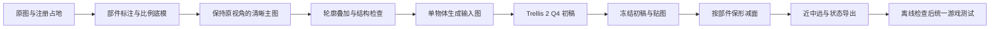

# 参考图一致性与保形减面方案

设计日期：2026-10-12。目标是让清晰参考图忠实于原始像素贴图，再把 Trellis 初稿减到相关 Worldfall 模型的面数范围，保留初稿的轮廓、结构、孔洞和颜色分区。

重复执行的入口已整理为 [Worldfall 建模技能](../../.agents/skills/worldfall-modeling/SKILL.md)，实际操作与失败经验见[建模流程与经验](建模流程与经验.md)。这两份材料区分实验候选、文件核对与游戏验收，不把当前样板的失败记录当作已通过规范。

三个群系建筑的新参考图、真实Trellis初稿、全过程显存采样及Blender三档候选已完成，独立重开与实际导出文件核对通过。三张参考图的轮廓重合为88.49%–89.24%，未达到90%目标；熔炉和王座为保留形态仍超预算，祭坛三档面数通过但轮廓和细符文未全部保持。目前没有一座同时通过全部目标，不能视为流程验收通过。详情见[三个样板执行记录](<D:/Program Files (x86)/Steam/steamapps/common/worldbox/Mods/Cultiway-Reborn/Doc/修仙贴图三维化/参考图一致性与保形减面/2026-10-12-三个样板执行记录.md>)。统一游戏测试尚未执行，旧低面风格预览保留为历史版本。

可直接参考 [颅献黄铜王座样板流程](<D:/Program Files (x86)/Steam/steamapps/common/worldbox/Mods/Cultiway-Reborn/Doc/修仙贴图三维化/参考图一致性与保形减面/样板流程-颅献黄铜王座.md>)：从原图和18×8占地开始，逐步完成参考图、初稿与近中远候选，并分别检查三个环节的偏差。

本轮成果见三个样板检查包（历史文件已清理）。四阶段图像、可编辑模型、三档导出、实测与显存日志按物体集中保存。

## 已确认的事实

- 本机实际运行的是 **TRELLIS.2-4B 的第三方 C++ 量化实现** `pwilkin/trellis.cpp v0.8.1`，权重为 `ilintar/trellis2-gguf` 的 Q4，使用 512 档、12 步、2048 贴图。当前已经在使用 Trellis 2。
- 显卡为 RTX 3060 Laptop，专用显存 6,144 MiB。本轮三次真实推理的整卡采样峰值为3,437–3,586 MiB，峰值减运行前背景的近似增量为2,324–2,464 MiB；不是逐进程显存，也不保证捕获短时尖峰。
- 官方 TRELLIS 1 支持实验性的多图输入；当前官方 TRELLIS 2 生成入口和本机运行器均为单图入口。检查用三视图应保存为独立文件，当前生成时只输入一张完整物体图。
- 旧参考图提示词提前要求小于约 1,500 面、粗大几何、减少尖刺，且允许改变柱高。这些要求已影响参考图形态。
- 占地须读取注册数据：七重溃烂熔炉 10×6、颅献黄铜王座 18×8、万变星璇祭坛 19×7、大殿 15×7。原图的二维宽高比不能直接当作地面深宽比。

## 制作流程

每个资产保存三组对比：**原图→清晰主图、清晰主图→Trellis 初稿、Trellis 初稿→减面模型**。检查只使用同相机、同尺度的对应视图，分别定位参考图、生成和减面造成的偏差。

## 核心规则

1. 参考图先保持原图视角、外轮廓、部件数量、相对位置和主色分区。取消提示词里的三角面预算，几何风格在后续减面和着色中处理。
2. 原图、占地、比例底模、材质分区承担不同约束：原图规定可见外观，注册数据规定地面范围，底模规定深度和部件关系，材质分区规定国家色等可变部分。
3. 每个物体以自己的实际 Trellis 初稿作为减面来源。逐步减少面数、保护薄片与孔洞、按识别特征分配预算；整体替换为基础几何会改变形态，保形减面流程不采用这种做法。
4. 面数按相关 Worldfall 模型分别确定近中远预算。原始初稿、减面候选和生产资源分版本保存，保形检查未通过的候选保留失败记录。
5. 多视图从同一个比例底模或同一个已固定的初稿渲染，保持尺度、姿态和部件一致。遮挡面的补全属于设计假设，必须记录。
6. 每批最多三个独立建模子代理，每个只处理一个资产；本机 Trellis 推理逐个执行。先完成模型，之后统一游戏测试。

## 分阶段文档

- [第0阶段：现状与 Trellis 选择](<D:/Program Files (x86)/Steam/steamapps/common/worldbox/Mods/Cultiway-Reborn/Doc/修仙贴图三维化/参考图一致性与保形减面/第0阶段-现状与Trellis选择.md>)：三视图支持、显存差距、版本选择和证据范围。
- [第1阶段：原图约束的参考图](<D:/Program Files (x86)/Steam/steamapps/common/worldbox/Mods/Cultiway-Reborn/Doc/修仙贴图三维化/参考图一致性与保形减面/第1阶段-原图约束参考图.md>)：占地、比例底模、图像编辑、提示词和检查标准。
- [第2阶段：初稿保形减面](<D:/Program Files (x86)/Steam/steamapps/common/worldbox/Mods/Cultiway-Reborn/Doc/修仙贴图三维化/参考图一致性与保形减面/第2阶段-初稿保形减面.md>)：原生模型预算、部件保护、逐级减面及材质处理。
- [第3阶段：样板与采样](<D:/Program Files (x86)/Steam/steamapps/common/worldbox/Mods/Cultiway-Reborn/Doc/修仙贴图三维化/参考图一致性与保形减面/第3阶段-样板与采样.md>)：首批物体、对比产物、显存记录和后续执行顺序。

## 资源说明

| 资源 | 用途 | 当前状态 |
| --- | --- | --- |
| 原始贴图与注册占地 | 外观和尺寸依据 | 已有，已核对前三栋群系建筑 |
| Worldfall 内置面数清单 | 选择相近模型的近中远预算 | 已完成，4,117 个定义 |
| 三栋旧风格检查包 | 对照当前偏差 | 已有，保留历史版本 |
| 比例底模、部件标注、清晰主图 v2 | 新方案的参考图样板 | 已制作，参考图轮廓目标未通过 |
| 新 Trellis 初稿 | 各物体本轮真实生成来源 | 已生成，137,450–148,294面；发现的几何问题另记 |
| 三档减面候选与多方向对比 | 检查模型对初稿的形态保持 | 三份实验候选已完成，保形未全部通过，失败版本保留 |
| Trellis 推理显存曲线 | 记录 512/Q4 的真实采样峰值 | 三次已采样，CSV、背景范围与阶段日志齐全 |

官方原版的最低显存要求是 TRELLIS 1 至少 16GB、TRELLIS 2 至少 24GB。当前 6GB 机器继续使用已跑通的 512/Q4 C++ 路径；官方原版和高分辨率档不列为已通过。来源和限制见第0阶段。
