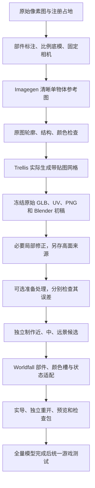

# 修仙单位与建筑建模流程及经验

整理日期：2026-10-12。本文总结实际采用的制作流程，也记录尚未解决的问题。三个实验样板已形成可检查的四阶段成果，但没有一座同时通过参考图、面数、保形和颜色细节的全部要求；流程可复用，不代表这批模型已经验收合格。

供代理使用的入口是[Worldfall 建模技能](../../.agents/skills/worldfall-modeling/SKILL.md)。完整设计见[参考图一致性与保形减面总览](参考图一致性与保形减面-摘要.md)，本轮数字见[三个样板执行记录](参考图一致性与保形减面/2026-10-12-三个样板执行记录.md)。

## 一条完整的制作链



偏差分开看：原图到参考图检查清晰化是否改了结构；参考图到初稿检查单图生成是否补错；原始初稿到修正源检查人为修改；修正源到准备网格、最终候选检查整理和减面损失。不能把所有偏差混在一张漂亮的预览里。

## 1. 先锁定物体和参考图

读取原贴图、注册宽深与本物体 Seed。结构表记录部件数量、位置、相对高度、材料、国家色、孔洞、前后关系以及看不清的部分。二维图片宽高比不能代替建筑地面的深宽比。

用 Blender 比例底模确定深度和相机，再让 Imagegen 按原图清晰化。原图负责外观，底模负责体量和地面关系；背面及不可见内部是设计假设。参考图阶段不设置三角面上限，也不以“低面风格”为理由删尖刺、缩柱或填开口。

原图与清晰图只做平移和等比缩放，不能分别拉伸宽高来提高重合分数。按透明通道比较轮廓，另查关键部件。本轮透明轮廓使用透明度至少128的像素；保存对齐参数，后续版本使用一致口径。

本轮设定的参考轮廓目标是至少90%。原图一个像素容差内覆盖只是辅助检查：两项计算不同，不能用接近100%的容差覆盖宣称90%轮廓目标已经通过。高分辨率也不等于结构一致性分数高。

额外正侧背俯视图来自同一个底模，生成之后来自同一个固定初稿。不要分别用提示词重新设计几个视角，再把它们视为一个一致物体。本机当前 Trellis 入口是单图；最终输入只放一个完整物体，透明背景，无文字、网格、多个视角或额外平台。

## 2. 实际生成并冻结初稿

先核对 `Scripts/Worldfall/trellis-config.json` 和[Trellis 使用说明](../../Scripts/Worldfall/Trellis使用.md)。本轮配置是 TRELLIS.2-4B、第三方 C++ v0.8.1、Q4、512档、12步、seed42、2048 PNG贴图。它是这次运行的记录，后续改变版本或参数须另记。

在仓库根目录的调用方式如下；生成前设置实际资产与尚未使用的版本，准备对应输入图。

```powershell
$taskAssetId = 'Cultiway.SectHall'
$taskRevision = 3
& 'Scripts/Worldfall/trellis.ps1' -Mode Check
& 'Scripts/Worldfall/trellis.ps1' -Mode Generate -AssetId $taskAssetId -Revision $taskRevision
```

默认变体的输入是 `reference/trellis-input-v<版本>.png`，输出是 `trellis/generated-v<版本>.glb`。分版本参考目录中的输入与运行入口处的输入保持相同字节，并记录校验值。脚本会拒绝覆盖已有输出；不要删旧结果来强行重跑同一版本。

保留生成记录、日志、GLB、原 PNG、UV 和导入后的 `source-locked.blend`。C++运行器输出已经包含后处理，统计报告使用实际GLB三角面数，不将它称为未经处理的生成网络面数。

当前三个样板原始面数为142,422、148,294、137,450。生成成功只说明得到文件，仍须检查是否出现背景板、错误厚度、封口、漏件和侧背补全错误。

## 3. 区分修正、准备处理和减面

初稿本来就错时，先明确局部修正或重新生成。修正版本另存，写明改动范围并展示前后。例如本轮熔炉删除误生成背景板，王座调整局部纵深，祭坛调整低台基；这些不是减面本身，也不能说初稿原本符合占地。

每个物体从[Worldfall 内置面数报告](验收/2026-10-12-Worldfall内置面数/README.md)选2–3个用途和复杂度接近的参照，再写预算。原生模型只承担复杂度参照，不能替代自制物体的外形。三个样板的近中远预算分别约为3300/1700/700、5000/2500/1000、5000/2500/1000。

在真实高面副本上保护重要孔、尖角、薄框、屋檐、细柱、脸手、衣摆与脚底。静态建筑可先整体减面后归回原部件；人物必须保留真实动作关节。颜色边界的硬切会制造额外碎片和开放边，不能一律照搬静态或人物的处理顺序。

若实际面数停在高位，先检查断开片段、贴图接缝复制点、只共点接触、多面共边和塌陷薄壳。不要只反复降低一个比例。本轮王座原网格含8461个片段，即使焊接也不能自动解决所有接触。

体素重建是可选的准备处理，可能连接碎片，也可能填孔、吞薄件或保留大量微小隧道。尺度按真实孔宽和薄件选；1/512不是通用标准，闭合也不代表适合低面。保存准备文件，并对原修正高面来源单独计算误差。准备阶段已经丢失的东西，后续增加面数不能找回来。

近、中、远各自从同一个固定来源复制制作，分别统计真实三角面。不要连续在已经失形的低面网格上继续减，也不能复制同一网格三次宣称完成了三档减面。确实复用某档时写明原因。

每次试验对应一个已见问题和预期效果。没有新依据时停止参数搜索；可以交付较完整的高面候选并标明超预算，保存低面失败对照。不能改预算或误差基准，把失败候选重新包装成通过。

## 4. 适配 Worldfall 的运行约定

细节以[建模约定](../../Scripts/Worldfall/建模约定.md)和本物体 Seed 为准。

| 项目 | 约定 |
| --- | --- |
| 坐标与朝向 | X左右、Y前后、Z向上，正面-Y；单位脚底与悬浮间距明确记录 |
| 建筑占地 | 台基宽归一为1，深宽按注册值；屋檐可伸出，但不能拉宽物体或新增基座填满占地 |
| 动作 | 保留部件名称、父子关系、真实转动轴；人物可参考人类姿态关系，非人形使用自身结构 |
| 色槽 | 每模型最多64槽，包括原槽前缀，逐面槽号有效；材质类别与国家色分开处理 |
| 文明木构 | 原图确定的变色瓦顶跟随国家，墙柱梁保持木色，固定饰物单独分槽 |
| 人物 | 国家衣料、肤色、头发分别处理，不将装备烘焙进身体 |
| 诡族 | 固定浅绿灵体配色、中式结构；基础住宅是敞开空棺，有内腔与抬起的棺盖 |
| 三栋群系建筑 | 本轮为固定颜色，`kingdom_slots: none`；艺术紫色不一概当国家模板 |
| 建筑状态 | 保留真实状态名称及原有有效路径，施工和废墟不残留整座完好装饰，切换待游戏实测 |

原UV/PNG作为颜色来源，减面或重建后将颜色转到新表面。记录原色、量化后颜色与必要的艺术调整；调整后的颜色不能称为未改的PNG字节。GLB未声明颜色乘数时默认是1，不能误乘Blender材质默认值0.8。

逐面颜色受到面数和64槽限制。符文、脸纹等图案须单独实看，整体配色相近不能证明图案完整。本轮祭坛保留青蓝分布，但细符文已变成色斑。

Blender创建面色、原RGB等属性时，先设置 `material_index`、`use_smooth`，等属性创建完后按名称重新取句柄写值。隐藏模型的世界矩阵要在显式显示并更新场景后读取。不同距离档和完好/废墟材质使用不会冲突的名称，避免同名但不同颜色串用。

法线须有限、长度接近1，并与最终落盘网格核对。相反方向的薄布正反面不能平均成零法线；极瘦三角面经过浮点往返后可能改变面方向，须对真实导出结果核对，不能只检查导出前数组。

## 5. 分项检查，保存后独立重开

本轮设计目标如下。它们是明确的试验标准，不是所有模型永远适用的保证；后续如调整，记录版本和依据。

| 检查 | 近景 | 中景 | 远景 |
| --- | --- | --- | --- |
| 固定相机各方向最低轮廓重合 | 至少97% | 至少95% | 至少90% |
| 最大尺寸偏差 | 至多1% | 至多2% | 至多3% |
| 双向表面采样距离的95分位 | 至多整体对角线1% | 至多2% | 至多3% |
| 关键孔、薄件、数量与关系 | 分项检查 | 分项检查 | 核心结构可辨 |

轮廓重合比较纯色外形的交集与并集，颜色另用材质图检查。表面距离采用双向采样，避免只从低面采样而漏掉消失的细枝。列明实际相机方向、采样数和归一方式；没有测到的视角不写通过。

最终保形指标对原修正高面来源计算，不能改成对准备网格计算。参考图一致性、初稿修正、准备处理误差、预算、轮廓、尺寸、表面距离、关键部件、颜色细节和游戏状态各自记录。某一指标通过不抵消其他失败。

实际保存候选，另起Blender进程重开；重新导入GLB/FBX，比较面数、位置、UV、颜色和法线，同时核对原槽前缀、部件、父子关系与轴。仅验证文件校验值不够。最终预览由重开后的实际文件渲染，查看正面、侧面、背面、俯视及三档距离。

实验阶段只写 `models.candidate.json` 和 `Art/Worldfall/` 成果。`Scripts/Worldfall/blender_worldfall.py` 的 `Asset.export()` 默认写生产 `Content/Worldfall/Models/<资产ID>/models.json`；群系建筑继续制作时新增显式 `output_path` 参数，可指定候选JSON路径，同时将模型、检查记录和后续预览保存到该候选目录。实验脚本必须显式传入候选路径。

## 6. 文件、显存和检查包

| 位置或文件 | 内容 |
| --- | --- |
| `reference/v<版本>/` | 原图、结构、比例底模、相机、提示词、选用图、叠加与参考检查 |
| `trellis/generated-v<版本>.*` | 真实生成的GLB、贴图及其他原始输出；同目录保留生成记录 |
| `source-locked.blend` | 原始初稿、固定尺度、原UV/PNG |
| `source-corrected.blend` | 有明确依据的局部修正，另附前后对照 |
| 准备来源、`budget.json`、`protected-regions.json` | 实际准备网格、原生参照和重要区域 |
| `candidate-v<版本>.blend/glb/fbx` | 近景候选与可编辑来源，另附中远景GLB |
| `models.candidate.json` | 待接入的Worldfall数据 |
| `shape-check.json`、`reopen-check.json`、`summary.json` | 几何实测、独立重开及简表，保存通过项与失败项 |
| `preview-*.png`、多方向对照 | 从真实最终文件生成的近中远与正侧背俯视图 |
| 显存CSV、运行日志、生成记录 | 全过程采样、背景范围、实际参数与输出信息 |

显存采样从启动前10秒持续到结束后10秒，请求间隔约200毫秒，记录实际间隔、时间戳和阶段。报告整卡峰值、背景范围、近似增量；进程数据取不到时标不可用，短时尖峰可能漏采。

本轮整卡峰值3437–3586 MiB，峰值减背景约2324–2464 MiB。它不是Trellis进程独占峰值，也不能推出官方实现或1024档能在本机运行。完整条件见执行记录。

检查包每个物体一文件夹，并列原图、清晰参考、真实初稿和最终候选，附可编辑来源、三档导出、同相机对照、报告和日志。原图等比最近邻放大，不能保留成难以观察的小缩略图。检查页所有链接实际存在，文件清单附大小和校验值。

## 7. 子代理分工、现有工具和收尾

本项目每批最多三个建模子代理，每个只处理一个物体，不再派生；同一物体持续修正交回原代理。主代理负责范围、版本、统一约定、显卡排队、收集结果与检查包。各代理仅写自己的目录，不读取别人的模型来替代本物体的初稿。

| 工具或记录 | 用途与范围 |
| --- | --- |
| `Scripts/Worldfall/trellis.ps1`、配置文件 | 正式的单物体分版本生成入口 |
| `Scripts/Worldfall/blender_worldfall.py` | 读取运行约定与发布导出；`export()`会写生产资源 |
| `tmp/WorldfallAcceptance/check-reference-v2.py` | 本轮参考轮廓检查实现参考，使用前核对入口参数与资产列表 |
| `tmp/WorldfallAcceptance/trellis-v2-sampled.ps1`、`summarize-gpu-v2.py` | 本轮三栋建筑的显存采样及汇总，资产范围固定 |
| `tmp/WorldfallAcceptance/package-shape-v2.py` | 本轮三个样板的检查包，固定资产、版本、文件名，不是全资产通用打包器 |
| 本物体 `shape-preserving-v2/` 内脚本 | 该物体修正、准备、减面与重开实现，避免把切割参数移植到别的物体 |

当前收尾结果：熔炉19999/17499/14999面，王座20000/4200/3628面，祭坛5000/2500/1000面。三者文件核对通过，保形均未全部通过，只有祭坛符合预算。熔炉圆口粘连、王座细节丢失、祭坛符文失真均记录为限制。

本轮四阶段检查包（历史文件已清理）保留实际成果和失败对照。后续先解决具体缺陷，已有失败原因不能仅靠增加面数掩盖。

按用户安排，先完成全量模型，再使用仓库 `debug` 技能统一游戏测试：固定无遮挡场地、截图实际刷新、人物正侧背与动作、脚底和衣摆、建筑落地与入口、近中远、施工/完工/废墟、国家色、选择操作和修炼状态映射；另测关闭3D、没有Worldfall以及版本不匹配。离线结果不能替代这些运行验收。
