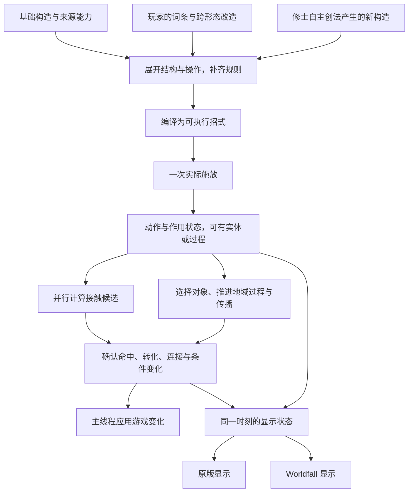

# 技能系统全面重构

**状态：已开始分阶段实施，首轮资源、少量构造、学习施放及冷启动恢复已验证。** 进展与限制见[实施记录](技能系统全面重构/实施记录.md)；真实战技、完整创作范围、各来源迁移和最终画面仍在待办。本方案接替旧路线的局部外观修补；旧批量录制继续停止。既有质量问题见 [暂停点与问题诊断](战斗表现重构-问题诊断.md)。

**统一待办：[全程实施 TODO](技能系统全面重构/全程实施TODO.md)。** 从能力盘点、模型接入、构造与自主创法，一直列到全量内容、跨尺度、存档、性能、清理发布和最终视频验收。后续以该清单逐项记录实现和证据，本页保留目标及阶段总览。

## 已确认的目标

- 技能同时覆盖生活、修炼、生产、探索、交通、救灾与战斗；支持个人、局部战场、城市和世界尺度，包含持续过程、长期设施、连接关系与永久变化。
- 战斗丰富度参考 CombatGods：身体动作、法术、法宝、受击和场地形成实际交锋。
- 动画精细度参考鬼谷：明确轮廓、连续运动、局部细节与遮挡层次，最终以游戏内画面判断。
- 同时支持原版观察、Worldfall 三维观察与第一人称；共用战斗结果，不以丢掉材质细节换取“能够显示”。
- 游戏内保留词条、轨迹、元素、范围、时长等改造，并正式支持跨形态：例如原地掌击改成追踪飞掌。
- 招式由可嵌套的形体、材料、运动、变化、关联和作用构造；同一套能力能生成未预先写好的变体，不将丰富度寄托于继续堆整招特例。
- 游戏内修士能自主生成未预先登记过的法术构造，形成正式已学能力，持续使用、保存及继续改造；与玩家编辑共用构造和编译入口。
- 战技同样可构造和自主创作，覆盖身体部位、支撑重心、握持、步法、发力及双方接触；骑士、修士和非人身体共用基础，不限于迁移现有九项骑士战技。
- 支持法术碰撞、格挡破盾和有限、明确的元素相互作用。修士自主频繁施法，允许多招同时存在；没有固定连招配方和组合编辑器。
- 并行计算、批量处理与显示开销从基础设计考虑；性能和画面都需要实际测量。
- 正式存档继续可升级，稳定编号与资料转换不中断。旧预览兼容范围沿用既有约定。

## 系统的基本单位

一次能力及其产生的变化由“对象与关系、作用、持续过程、施放方式、动作与表现”共同定义。攻击法术是其中一类；能力可以改变物件、建立连接、控制过程或施加世界条件，不必产生投射物或发生碰撞。

具体能力设想见 [能力版图与尺度设计](技能系统全面重构/能力版图与尺度设计.md)，包括控水、活木、搬山、炼造、空间、时间、信息与法则等方向，以及它们在不同尺度的功能和战斗用途。

[生成式法术构造方案](技能系统全面重构/生成式法术构造方案.md)说明这些能力如何产生：[攻击法术构想](技能系统全面重构/攻击法术构想与制作要求.md)中的十三项是表达能力用例，不是十三个完整技能类。构造允许嵌套部件，操作能作用于部位、集合或过程，规则补齐必要的运动、作用区和收尾。新原理扩充共用操作，新造型扩充可变资源，再与已有构造结合。

[代码结构与模型接入设计](技能系统全面重构/代码结构与模型接入设计.md)进一步说明定义、编译计划、施放状态的分工，以及模型资源、语义部位、动作、实际作用区和两种显示怎样接在一起。

[战技构造与身体动作拓展](技能系统全面重构/战技构造与身体动作拓展.md)补齐动作自身的自由度，包括抓投、拨压、卸力、不同身体与兵器适配、自主创作和宏观发力。战技与法术共用构造，具体动作需要真实身体及资源支持。

| 部分 | 负责的内容 |
|---|---|
| 对象与关系 | 人物、器物、地块、区域、过程、网络节点、空间连接与世界条件 |
| 作用 | 损伤与恢复、生成与转化、搬运与连接、过程改变、条件建立及其成功要求 |
| 持续过程 | 展开、传播、维持、转化、衰减、完成与留下结果；可以在施法动作结束后继续 |
| 投送方式 | 接触、飞行、推进、射线、区域、环绕、附着，也可直接指定对象、沿网络传播或作用于规则 |
| 运动轨迹 | 直行、追踪、弧线、螺旋等，输出真实位置、朝向和路径 |
| 动作 | 人物与法宝的蓄势、释放、有效时段、挂点、收势和中断 |
| 表现 | 形体、材质、形变、局部粒子、声音，以及实际接触后的反馈 |

这些是开发和运行时的组织方式。玩家继续通过万法阁中的改造选项使用它们，无需连接节点或编辑多招配方。字段的具体呈现复用项目现有 UI 规范。

例如“掌击 → 追踪飞掌”：保留掌击的作用定义，投送方式改为离手飞行，获得飞掌主体、追踪目标和对应判定；施法者完成发掌动作，飞掌离手后独立运行。巨大、齐射和急速再共同修改实体数量、尺寸、动作时点、成本与表现。

引河则确定水源、去向、流路和推进过程；门户建立并维持两个地点的连接。它们需要真实改变对应玩法，不能改写成一次命中加动画。境界、威力、覆盖、精细程度、持续与永久程度分别设计，顶尖角色也能施展精细小术。

## 执行结构

构造展开与编译发生在创建、编辑或升级招式时。运行中执行紧凑数据，按实际状态、条件和结果推进变化，不逐帧重建定义。一次施放固定使用开始时的版本，编辑不会突然改变已经飞出的法术。同类运动、生长、材料变化和作用区更新跨招式批量处理。

空间作用的形状、范围和生效时点由运行状态提供，显示不得自己猜一个半径。地域过程与世界条件也提供真实进度和结果，绘制不直接修改玩法。人物、器物和法术的显示读取同一动作过程，受击、转化、设施建立与破碎读取真实结果。

## 并行与性能边界

- 主线程读取游戏对象，整理本轮只读数据；线程之间传递编号、数值和数组，不传递可随时变化的 Actor、Transform 或材质对象。
- 轨迹、形状更新、空间筛选、精确接触候选及部分姿态计算可以批量并行。
- 多个法术命中同一护盾等冲突按接触时序统一处理；原版伤害、死亡、地形修改、资源扣除和图形对象操作留在受控提交阶段。
- 接入已有模拟调度与线程预算。现有工作池和 Friflo 的并行能力都需要实测选择，不再另起多个互相争抢的线程池。
- 单线程与并行模式应产生相同的技能结果；整个 WorldBox 的第三方回调不据此宣称完全确定。
- 常用场景以 60 帧为目标，具体设备、世界规模、原版开销和三维开销分开记录。并行加速比及可承载数量必须测量，不能提前保证。
- 无害粒子、材质细节和远景层次可以缩减；已产生的攻击不得因显示预算被漏算。需要玩法数量上限时另行明确设计。
- 城市与世界作用按实际过程分区推进，世界条件按事件和查询参与；近身接触、地域过程与长期规则不强制采用同一更新频率。显示必须对应实际进度，不提前播放已经完成的世界变化。

## 重构范围

| 范围 | 处理原则 |
|---|---|
| SkillLibV3 的定义、改造编译、动作与判定 | 允许整体替换，不沿旧轨迹类别继续叠限制 |
| 散落的通用视觉、法宝显示与动作状态 | 归入同一施放过程和结果数据，逐步删除重复入口 |
| 学习、施放入口、资源支付、法宝与器官来源 | 按新合同接入，必要时调整；每个能力只保留一个结算拥有者 |
| 原版与 Worldfall 显示 | 共享状态与资源意图，分别实现绘制；三维材质接入尽早验证 |
| 存档、蓝图和万法阁 | 通过逐版本转换迁移，玩家改造和已学能力不能因换运行框架静默丢失 |
| 性能调度 | 复用已有固定步和线程预算，避免增加另一套技能时钟 |
| 旧动画与模型 | 逐项评估，未达标者重制；已有文件不等于新质量目标已完成 |

通用定义与计算拟放在 `Source/Core/Skills/`；修仙招式、元素反应和具体内容放在 `Source/Content/` 对应玩法目录；Worldfall 适配仍归内容侧兼容目录。核心层不得依赖具体修仙内容。最终目录随第一阶段验证收敛，不先铺满空接口。

覆盖对象包括修士普通与专属法术、近身格斗、兵器、法宝主动及被动、符箓、御器、护体、妖兽器官、天劫、周期状态与环境作用。现有 140 项演示登记只能作为起点，不能代替完整来源清单。

功能性能力还需接入工作、旅行、修炼、救灾与设施维护的触发入口。永久地形、收纳对象、门户网络或世界条件分别由对应玩法维护事实与存档，通用技能层负责调用和编排，不包办所有世界系统。

## 推进与验收

| 阶段 | 交付与通过条件 |
|---|---|
| [0：能力版图与跨尺度合同](技能系统全面重构/第0阶段-能力版图与跨尺度合同.md) | 明确个人功能、局部战斗、城市过程、世界条件的对象、作用、过程、结果与资料归属，核对共用构造能否表达 |
| [1：资源与双视角验证](技能系统全面重构/第1阶段-资源与双视角验证.md) | 带材质与动作的可变主体，在原版和 Worldfall 中保留细节、透明和遮挡；用不同构造检查资源复用，画面通过后再扩大迁移 |
| [2：构造生成与自由拓展](技能系统全面重构/第2阶段-招式定义与自由拓展.md) | 可嵌套构造、规则补全、跨形态与词条共同编译；共用能力冻结后仍能产生新变体，修士能够自主创法并学习、使用和保存，编辑、成本、作用与显示一致 |
| [3：动作判定与并行执行](技能系统全面重构/第3阶段-动作判定与并行执行.md) | 同一动作推进人物、器物与作用区；线程边界、接触顺序和结果一致性成立 |
| [4：功能交锋与世界能力](技能系统全面重构/第4阶段-完整交锋与各类能力接入.md) | 生活与工程能力有实际用途，近身、法术与法宝形成交锋，城市和世界作用逐类完成制作与验收 |
| [5：全量迁移与性能验收](技能系统全面重构/第5阶段-全量迁移与性能验收.md) | 全能力来源、旧档转换、自由改造、两种视角与规模测试完成，旧运行路径删除 |

每阶段同时验证画面和实际作用。全量遍历用于回归，不能代替动作与美术验收。第一阶段的材质接入若不可行，先调整接入方法，再推进依赖它的资源制作。

## 接下来的首批交付

首批贯通第0至3阶段的必要部分，交付“修士自主创法 → 成为已学能力 → 自主施放 → 真实作用及两种视角 → 保存再载入”的完整过程。各阶段的其他能力与全量迁移仍保持待实施，不以首批通过替代全部验收。

1. 明确最小构造、部位和保存合同，登记现有领悟、强化、学习、施法与存档的接入点。
2. 打通少量带材质、命名部位和连续动作的模型资源，先验证原版与 Worldfall 的透明、深度和空间对齐；其中包括真实身体接触战技及动作或作用不同的变体，再扩大资源制作。
3. 实现足以重组结构的少量共用操作、编译和执行，使动作、部位、作用区及显示读取共同状态；同类计算接入已有批量调度。
4. 接入修士自主生成构造、学习、使用和保存；固定共用资源与操作后，验证新的结构变体和不同修士的生成结果，录制短段实际画面并记录性能。

首批完成后，继续补齐身体发力、流体、法宝、关联作用与碰撞反应，再展开功能能力、城市及世界过程和旧内容迁移。旧全量录像与逐招外观修补仍暂停。

完整顺序、依赖、各流派与来源的覆盖要求，以及完成标准均列在[全程实施 TODO](技能系统全面重构/全程实施TODO.md)。当前从工作包0的范围与接入点、工作包1的模型和双视角技术验证开始，再贯通首批所需的构造、运行、创法和保存。

## 资源与制作要求

| 资源 | 必须保留的资料 |
|---|---|
| 人物、肢体、器物 | 合理轮廓、厚度、挂点，所需的姿态或骨架动作 |
| 流体、藤蔓及可变主体 | 连续形变、稳定表面坐标、分部位运动，生长或破碎过程 |
| 材质 | 材质分区、表面坐标、透明与边缘遮罩、明暗及流动参数 |
| 局部粒子 | 来源、速度、寿命、世界时间与接触依附关系 |
| 招式动作 | 蓄势、释放、生效、接触、回收和中断标记 |
| 地域与世界过程 | 分区传播、长期设施与连接、宏观天候或灵流、实际变化后的残留 |
| 两种显示 | 相同资源含义，明确各端如何实现透明、深度和材质；不静默降格 |
| 质量对照 | 静帧、常速近景、常用距离、城域远景、真实命中和落空 |

资源源文件、导出资料和游戏结果都要能追溯。已有 Three.js 制作工具与 Unity 资源构建可继续使用，但不能再只导出顶点和面色，丢掉制作预览中的材质和动作。参考包用于研究，不直接复制其素材发布。

## 当前待验证事项

Worldfall 的自定义材质和深度接入点、资源格式、原版身体姿态能表达的程度、线程任务的实际粒度和压力场景，均在第一阶段验证。它们没有被写成已经解决的能力。[参考与现状依据](技能系统全面重构/参考与现状依据.md) 记录本次核对范围。
