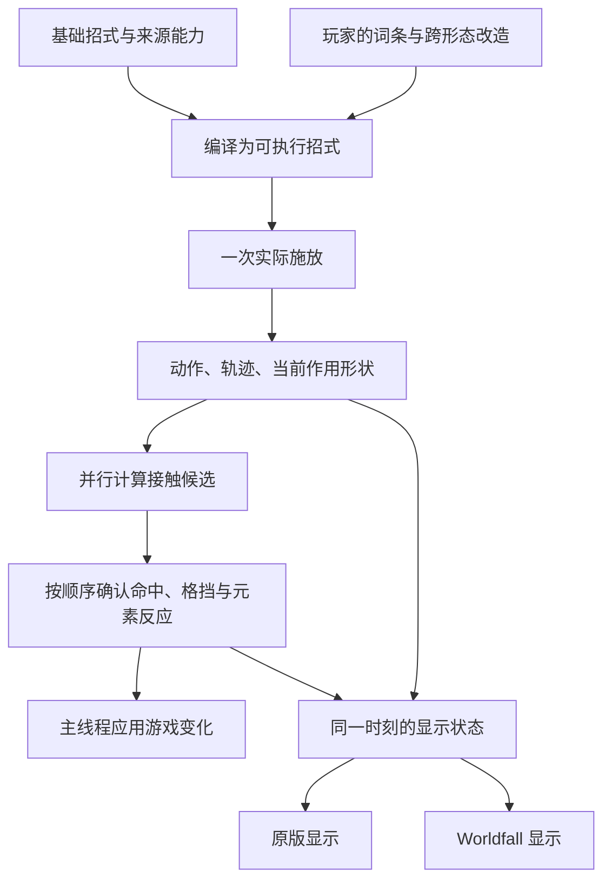

# 技能系统全面重构

**状态：整体设计讨论稿，尚未开始新框架实现。** 本方案接替旧路线的局部外观修补；旧批量录制继续停止。既有质量问题见 [暂停点与问题诊断](战斗表现重构-问题诊断.md)。

## 已确认的目标

- 战斗丰富度参考 CombatGods：身体动作、法术、法宝、受击和场地形成实际交锋。
- 动画精细度参考鬼谷：明确轮廓、连续运动、局部细节与遮挡层次，最终以游戏内画面判断。
- 同时支持原版观察、Worldfall 三维观察与第一人称；共用战斗结果，不以丢掉材质细节换取“能够显示”。
- 游戏内保留词条、轨迹、元素、范围、时长等改造，并正式支持跨形态：例如原地掌击改成追踪飞掌。
- 支持法术碰撞、格挡破盾和有限、明确的元素相互作用。修士自主频繁施法，允许多招同时存在；没有固定连招配方和组合编辑器。
- 并行计算、批量处理与显示开销从基础设计考虑；性能和画面都需要实际测量。
- 正式存档继续可升级，稳定编号与资料转换不中断。旧预览兼容范围沿用既有约定。

## 系统的基本单位

一次招式由“作用、投送方式、运动轨迹、动作、表现”共同定义，不再由原有实体类别决定一切。

| 部分 | 负责的内容 |
|---|---|
| 作用 | 伤害、治疗、护盾、控制、状态、地形变化，以及成功作用的条件 |
| 投送方式 | 身体接触、离手飞行、沿地推进、射线、持续区域、环绕或附着 |
| 运动轨迹 | 直行、追踪、弧线、螺旋等，输出真实位置、朝向和路径 |
| 动作 | 人物与法宝的蓄势、释放、有效时段、挂点、收势和中断 |
| 表现 | 形体、材质、形变、局部粒子、声音，以及实际接触后的反馈 |

这些是开发和运行时的组织方式。玩家继续通过万法阁中的改造选项使用它们，无需连接节点或编辑多招配方。字段的具体呈现复用项目现有 UI 规范。

例如“掌击 → 追踪飞掌”：保留掌击的作用定义，投送方式改为离手飞行，获得飞掌主体、追踪目标和对应判定；施法者完成发掌动作，飞掌离手后独立运行。巨大、齐射和急速再共同修改实体数量、尺寸、动作时点、成本与表现。

## 执行结构

编译发生在创建、编辑或升级招式时。运行中执行紧凑数据，不逐帧重建定义。一次施放固定使用开始时的版本，编辑不会突然改变已经飞出的法术。

作用形状和生效时点由战斗状态提供。显示不得自己猜一个半径；绘制也不产生伤害。人物、器物和法术的显示读取同一动作过程，受击与破碎读取真实结果。

## 并行与性能边界

- 主线程读取游戏对象，整理本轮只读数据；线程之间传递编号、数值和数组，不传递可随时变化的 Actor、Transform 或材质对象。
- 轨迹、形状更新、空间筛选、精确接触候选及部分姿态计算可以批量并行。
- 多个法术命中同一护盾等冲突按接触时序统一处理；原版伤害、死亡、地形修改、资源扣除和图形对象操作留在受控提交阶段。
- 接入已有模拟调度与线程预算。现有工作池和 Friflo 的并行能力都需要实测选择，不再另起多个互相争抢的线程池。
- 单线程与并行模式应产生相同的技能结果；整个 WorldBox 的第三方回调不据此宣称完全确定。
- 常用场景以 60 帧为目标，具体设备、世界规模、原版开销和三维开销分开记录。并行加速比及可承载数量必须测量，不能提前保证。
- 无害粒子、材质细节和远景层次可以缩减；已产生的攻击不得因显示预算被漏算。需要玩法数量上限时另行明确设计。

## 重构范围

| 范围 | 处理原则 |
|---|---|
| SkillLibV3 的定义、改造编译、动作与判定 | 允许整体替换，不沿旧轨迹类别继续叠限制 |
| 散落的通用视觉、法宝显示与动作状态 | 归入同一施放过程和结果数据，逐步删除重复入口 |
| 学习、施放入口、资源支付、法宝与器官来源 | 按新合同接入，必要时调整；每个能力只保留一个结算拥有者 |
| 原版与 Worldfall 显示 | 共享状态与资源意图，分别实现绘制；三维材质接入尽早验证 |
| 存档、蓝图和万法阁 | 通过逐版本转换迁移，玩家改造和已学能力不能因换运行框架静默丢失 |
| 性能调度 | 复用已有固定步和线程预算，避免增加另一套技能时钟 |
| 旧动画与模型 | 逐项评估，未达标者重制；已有文件不等于新质量目标已完成 |

通用定义与计算拟放在 `Source/Core/Skills/`；修仙招式、元素反应和具体内容放在 `Source/Content/` 对应玩法目录；Worldfall 适配仍归内容侧兼容目录。核心层不得依赖具体修仙内容。最终目录随第一阶段验证收敛，不先铺满空接口。

覆盖对象包括修士普通与专属法术、近身格斗、兵器、法宝主动及被动、符箓、御器、护体、妖兽器官、天劫、周期状态与环境作用。现有 140 项演示登记只能作为起点，不能代替完整来源清单。

## 推进与验收

| 阶段 | 交付与通过条件 |
|---|---|
| [1：资源与双视角验证](技能系统全面重构/第1阶段-资源与双视角验证.md) | 带材质与动作的主体，在原版和 Worldfall 中都能保留细节、透明和遮挡；实际画面通过后再扩大迁移 |
| [2：招式定义与自由拓展](技能系统全面重构/第2阶段-招式定义与自由拓展.md) | 跨形态、词条与轨迹共同编译，编辑、成本、范围与显示一致，资料可升级 |
| [3：动作判定与并行执行](技能系统全面重构/第3阶段-动作判定与并行执行.md) | 同一动作推进人物、器物与作用区；线程边界、接触顺序和结果一致性成立 |
| [4：完整交锋与各类能力接入](技能系统全面重构/第4阶段-完整交锋与各类能力接入.md) | 近身、普通法术、法宝、持续区域与反应形成真实交锋，逐类完成制作与实机验收 |
| [5：全量迁移与性能验收](技能系统全面重构/第5阶段-全量迁移与性能验收.md) | 全能力来源、旧档转换、自由改造、两种视角与规模测试完成，旧运行路径删除 |

每阶段同时验证画面和实际作用。全量遍历用于回归，不能代替动作与美术验收。第一阶段的材质接入若不可行，先调整接入方法，再推进依赖它的资源制作。

## 资源与制作要求

| 资源 | 必须保留的资料 |
|---|---|
| 人物、肢体、器物 | 合理轮廓、厚度、挂点，所需的姿态或骨架动作 |
| 流体、藤蔓及可变主体 | 连续形变、稳定表面坐标、分部位运动，生长或破碎过程 |
| 材质 | 材质分区、表面坐标、透明与边缘遮罩、明暗及流动参数 |
| 局部粒子 | 来源、速度、寿命、世界时间与接触依附关系 |
| 招式动作 | 蓄势、释放、生效、接触、回收和中断标记 |
| 两种显示 | 相同资源含义，明确各端如何实现透明、深度和材质；不静默降格 |
| 质量对照 | 静帧、常速近景、常用距离、城域远景、真实命中和落空 |

资源源文件、导出资料和游戏结果都要能追溯。已有 Three.js 制作工具与 Unity 资源构建可继续使用，但不能再只导出顶点和面色，丢掉制作预览中的材质和动作。参考包用于研究，不直接复制其素材发布。

## 当前待验证事项

Worldfall 的自定义材质和深度接入点、资源格式、原版身体姿态能表达的程度、线程任务的实际粒度和压力场景，均在第一阶段验证。它们没有被写成已经解决的能力。[参考与现状依据](技能系统全面重构/参考与现状依据.md) 记录本次核对范围。
