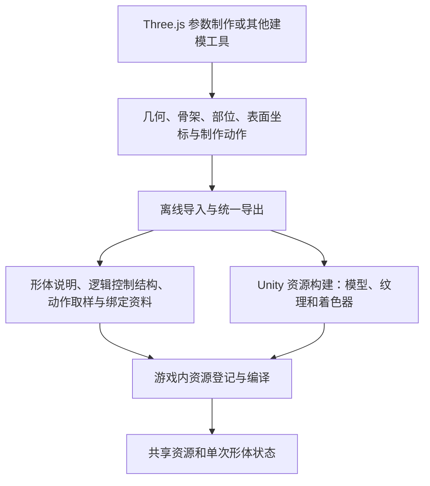

# 代码结构与模型接入设计

**状态：实现前的设计稿，尚未新增运行代码。** 本页把[生成式法术构造方案](生成式法术构造方案.md)落到代码职责、运行资料和模型制作流程。类型及目录名为建议，通过首轮端到端验证后再定型，不提前铺满接口。

## TODO

- [ ] [建立定义编译与执行的边界](#建立定义编译与执行的边界)。
- [ ] [实现通用操作及部位绑定](#实现通用操作及部位绑定)。
- [ ] [打通模型制作与发布](#打通模型制作与发布)。
- [ ] [共用姿态作用区和两种显示](#共用姿态作用区和两种显示)。
- [ ] [分批替换现有路径](#分批替换现有路径)。

## 具体说明

### 建立定义编译与执行的边界

三种资料分别保存：

| 资料 | 建议类型 | 保存什么、何时使用 |
|---|---|---|
| 构造定义 | `AbilityDefinition`、`ConstructionSpec` | 稳定编号、版本、结构、操作、条件、关联和玩家改造；用于制作、编辑及存档 |
| 已编译计划 | `CompiledAbility` | 已解析资源、紧凑操作及参数表、条件与输入输出绑定、执行体模板、成本及更新分组；同一版本共用 |
| 单次施放状态 | `CastState`、`FormState`、`ProcessState` | 本次来源、目标、阶段、时间、部位姿态、连接、物态、过程进度及已发生结果；每次施放独立 |

构造定义按“读取基础构造 → 应用玩家改造 → 展开共用规则和资源默认值 → 检查及补齐 → 计算成本和形状绑定 → 编译”的顺序生成计划。展开时保留哪些值由玩家明确指定，默认规则不能覆盖明确选择；结构改变后重新检查对应需求。

编译只解析描述，不能预先决定本次施放的目标和接触结果。运行时以本次输入绑定目标，按实际条件产生或解除部件与过程。编辑后产生新的编译版本，已开始的施放继续持有原版本。

编译计划按操作种类存放连续资料；施放实例只保存可变状态和共享计划的引用。运行中不遍历 JSON，不依靠反射找每个操作，也不为每个小部件创建带 `Update()` 的对象。

实际需要独立运动、接触或维持的对象使用现有实体系统管理。仅参与绘制的叶片、火星和表面细节放在实例资料中；功能能力也可只有过程或关系，不强制生成空间实体。

建议落点如下，实际从少量文件开始：

```text
Source/Core/Skills/
  Definitions/       构造、操作参数、部位、条件、关系与资料版本
  Compilation/       规则展开、改造应用、引用解析与计划编译
  Runtime/           施放、形体、过程、关系及作用结果
  Systems/           动作与过程推进、接触计算、结果确认及状态发布

Source/Core/Visuals/Forms/
                     模型资源、部位显示绑定、姿态取样与原版绘制

Source/Content/Skills/
                     具体法术、材料、反应规则与玩法作用处理
Source/Content/Compatibility/Worldfall/
                     Worldfall 的资源转换、绘制和身体对齐

Content/Skills/       法术与材料描述
Content/Forms/        形体说明、部位绑定、共用动作和导出资料
Content/AssetBundles/ 平台对应的模型、纹理及着色器资源包
```

核心只知道对象编号、结构、数值、过程与操作合同。五行反应、真元扣除、宗门规则等由内容层登记和实现，保持内容层依赖核心的方向。

### 实现通用操作及部位绑定

共用操作需要三部分：输入要求、编译展开方式、运行时批量处理。先用具体类型和明确的登记表实现，不给每个操作增加一套接口、工厂和中间服务。

| 部分 | 内容 |
|---|---|
| 输入要求 | 需要的形体、部位、材料、来源、目标或过程；输出可以被谁使用 |
| 编译展开 | 解析部位选择、建立连接和参数绑定、补齐必要状态，给出具体缺失说明 |
| 运行处理 | 推进数值状态，输出结构变化、接触候选或玩法作用请求 |

例如“分布”操作读取一个部位集合和子结构模板。树梢、鲸背和球面采样点只要提供需要的位置、朝向和分布资料，就可以成为输入。操作不判断输入属于哪个技能。

“解除连接”读取现有父子关系，将子结构的局部姿态换算为独立姿态，继承来源与必要运动，更新后续作用区和显示。旋转父体还应贡献脱落点的运动，不能只复制父体中心速度。

材料资料与显示材质分别设计：

- `MatterDefinition`、`MatterState` 描述实际材料、物态、可用变化及明确的交互参数。
- `SurfaceDefinition` 描述纹理、透明、受光、流向及其在两种显示中的实现。
- 材料状态选择对应的表面和变化资源。冻结可以改变实际物态并驱动外观；单纯染色只修改显示参数。

输入是普通形体、法宝本体还是器官部位，由绑定资料说明。独立生成的结构由施放负责回收；借用的法宝和身体部位只在结束时解除控制。现有 `SkillExecution` 已有生成与借用的区分，这个有效概念可以保留，不需要推倒所有来源系统。

下面是“倒悬冰剑树”的构造示意，并非已实现语法：

```text
树体 = 构形(树形资源，根部朝下，材料=木)
末梢 = 选择部位(树体，标签=枝梢)
剑群 = 分布(末梢，子结构=剑形资源，材料=冰)
生长(树体)
绑定(剑群成形进度，所在枝条生长进度)
启用作用(剑群.刃部，作用=穿刺)
当接触满足条件：解除连接(命中的剑，继承运动)
当冰剑满足碎裂条件：碎裂(对应的剑)
```

操作之间连接的是明确的结构、部位、状态或结果。目标死亡、枝条折断等输入变化有对应处理；不会把整份说明预先展开成一段无条件播放的录像。

### 打通模型制作与发布

当前已核对的限制：`Scripts/CombatModelStudio/generate.mjs` 的 `paint()` 删除位置、法向、颜色以外的属性，导出时又把部件合为一份几何；`SpatialModelLoader` 只读取位置、法向、三角形和面色。完整表面坐标、骨架、部位、材质分区和动作在这条链路中没有保留。

新流程建议为：



制作交换可采用 GLB 等通用格式；游戏发布采用现有资源包机制配合版本化的语义描述。是否选用相应离线导入工具，应先核对骨架、材质及动作能否完整转换，不在游戏中临时引入一整套模型导入依赖。现有 Unity 构建脚本目前处理着色器，需扩展后才能打包完整模型。

资源包中的模型用于保存标准几何、表面坐标、材质分区、骨骼权重和纹理；语义描述保存稳定编号、部位用途、控制点、连接、作用形状及生成参数。需要计算的几何和骨架资料在加载阶段按需读取一次，工作线程只拿纯数据，不从 Unity 对象取值。

逻辑空间沿用地图横向、纵深、离地高度的三轴约定。制作空间到逻辑空间的轴向、尺寸和原点在导入时统一转换；挂点、骨架、动作和作用形状同时转换。Worldfall 的地表承托在显示接入处处理，不能重复加到逻辑高度或由每个部件各自猜测。

制作动作中会影响实际接触的部分，离线导出为共用的姿态或控制点取样资料。游戏按动作阶段取样和插值，显示与作用区使用同一套变换；不另外编写一套只给碰撞用的近似动作，也不让每个显示对象自行推进动画。

人物、器官及持有法宝通过各自的身体和挂点绑定接入。原版精灵身体与 Worldfall 身体需要分别核对可用姿态和挂点；不能假定二者已有相同骨架。已脱离身体的法术主体则按自己的控制结构继续运行。

模型接入有三类，不要求一种方式包办：

| 主体 | 模型怎样提供 | 运行中怎样变化 |
|---|---|---|
| 剑、法宝、岩块等刚性器物 | 固定几何、材料分区、挂点、作用部位及可分离结构 | 整体变换、部件连接、局部响应与解体 |
| 鲸体、巨神和肢体等动态主体 | 有骨架或控制点的几何、权重、动作、部位与作用形状绑定 | 共用姿态驱动主体和有效部位，可叠加限定范围的弯曲及伸展 |
| 树根、水浪和扩张面等生成主体 | 分枝或曲面生成器、基础截面、材料、控制结构及变化参数 | 按生长或流动状态生成、激活和形变；保持可复用拓扑，不逐帧重做整个模型 |

高质量特殊轮廓仍需制作。通用操作扩大已有资源的用途，不能宣称一套低面球体和方块就能自动生成精细鲸体、古树或天炉。

### 共用姿态作用区和两种显示

`FormDefinition` 记录逻辑部位和控制结构，`FormVisualResource` 将模型部件、骨骼及表面绑定到这些部位。加载时把名称解析成索引；运行时按索引更新，不逐帧按字符串找骨骼。

一个剑形资源可提供如下绑定：

| 资料 | 剑形中的例子 | 用途 |
|---|---|---|
| 控制结构 | 剑根、剑尖、整体轴向 | 位姿、弯曲或长度变化的共同依据 |
| 语义部位 | 刃部、剑脊、剑柄 | 操作选择、实际作用和局部反馈 |
| 挂点 | 握持点、连接点 | 手持、聚合、附着或释放 |
| 作用形状 | 随剑根与剑尖运动的刃部薄体 | 启用后做接触与连续扫掠 |
| 显示分区 | 刃面、剑脊、纹饰 | 分别绑定表面和局部效果 |
| 变化支持 | 可脱落部件、预分块或限定形变 | 供解体、碎裂及材料变化使用 |

骨架、控制点和生成进度是主体与作用区的共同依据。鲸腹压落时，腹部作用形状随同一控制结构运动；树根尚未长出的部分没有实际抓持。碰撞可使用简化形状或多个形状，但其误差需符合画面尺度，不能把整个复杂主体退回中心球。

只影响装饰的细小水纹、火舌和碎沫可在绘制端变化；改变主体轮廓、危险边界或接触时点的变化必须进入共用状态。细节、采样密度和绘制层次按距离调整，不能通过减少显示预算漏算既有作用。

原版绘制负责把共同空间和姿态转换到原版视角，Worldfall 绘制负责三维空间、地面承托、身体对齐与实际深度。两端消费相同的显示快照，不推进施放或重新结算作用。

当前 Worldfall 接入把几何转换为颜色槽、材料类别和标记，`Pack()` 固定颜色内部透明度，整体另传透明参数；它不能直接承接新资源的完整材质。第一阶段需验证扩展其模型提交，或接入其实际绘制过程并取得视点与深度。现阶段没有确认哪条路线能保留全部材质，不能将普通 Unity 模型加载成功作为兼容完成。

### 分批替换现有路径

先保持学习、来源和施法请求入口，通过一个明确入口选择已迁移能力的当前实现；每项能力始终只有一个结算拥有者。临时迁移入口随全量接入删除，不长期保留两套执行系统。

每个模拟步仍接入现有调度：主线程读取必要快照，按同类操作分批计算，合并确认相撞、破盾与状态变化，再有序调用游戏接口，最后发布完成状态。改变运动或连接的结果必须使相关旧候选失效，不能拿改变前的路径继续命中。

形体姿态、轨迹、作用形状和接触候选可用纯数据批量并行；共享实体增删、伤害、地形、材质与模型对象操作保留在受控阶段。使用现有工作池或已测量的实体并行入口，不每个技能另开任务，不在全局实体写锁中等待工作线程。

存档保存可升级的构造、改造、稳定编号及需要持续的玩法事实；编译计划、资源包对象和绘制状态不入档。法宝、器官、门户、地域工程分别由对应玩法维护事实和保存，技能层维护本次执行关系。

首轮应端到端完成一个带命名部位和材质的形体、最少量的通用操作、一个原始构造及两种明显不同的变体；其中一种在共用能力冻结后提出。两种视角、实际接触、编辑后保存载入一起验证。之后再扩大到关联作用、其他资源类型、功能能力和各尺度。

## 资源说明

| 资源或工具 | 需要交付的资料 |
|---|---|
| 形体说明 | 稳定编号与版本、单位和坐标约定、控制结构、部位、挂点、连接与支持的变化 |
| 模型与表面 | 几何、表面坐标、法向及所需切线、材质分区、透明、纹理和形变资料 |
| 共用动作 | 姿态或控制点取样、阶段标记、适用部位与调整范围；原版身体单独绑定 |
| 作用形状 | 绑定部位、局部形状、启用条件、高度语义和随形变更新方式 |
| 生成资源 | 分枝、截面、曲面及可复用拓扑，参数如何驱动实际结构与显示 |
| 变化资源 | 连接解除、碎裂、冻结、流散或生长所需资料及缺失说明 |
| 导出与构建 | Three.js 制作源、离线转换、Unity 资源包构建及资源完整性检查 |
| 接入验证 | 原版与 Worldfall 的静帧、动作、遮挡、透明、真实作用及性能记录 |

本页细化第1、2、3阶段，不新增独立的全部框架搭建阶段。最终类型以真实用例需要为准，不根据目录表一次性创建空壳。
