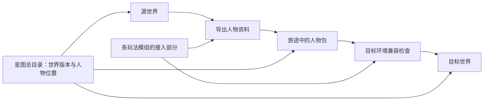

# 星图跨界旅行：设计方案

日期：2026-10-21。状态：设计稿，尚未实现。

## 目标与已确认范围

制作一个独立的 WorldBox 模组，让人物在多个存档之间旅行，并能经过明确的兼容处理，进入使用不同模组配置的世界。用户已确认采用“跨存档旅行，并兼容不同模组配置”。

参考图提供三个玩法方向：一份世界存档显示为一颗星球；地图越大，星球显示越大；人物可以乘飞船或通过飞升前往其他世界。图中的文字作为设计参考，本方案将星图做成新的世界管理入口，底层继续使用原版世界存档。

推荐暂名“星途”。旅行模组负责人物运输和世界管理，各玩法模组负责说明怎样携带自己的数据。

## 玩家能得到什么

1. 将已有存档加入星图，或在星图中新建世界。
2. 选择人物、目标星球和落点，查看携带清单后出发。
3. 人物从出发世界离开，在目标世界出现，保留身份、年龄、可用装备和受支持的玩法数据。
4. 目标环境缺少某种能力时，按该能力的接入规则封存，返回支持它的环境后恢复。
5. 旅行中断后，可以继续抵达或返航；已经抵达的人物不会因重复点击再次生成。

例如：一个修士离开修仙世界，重启到仅装旅行模组的原版玩法环境。他的修为、功法和法宝封存在人物资料中，原版部分正常活动。进入其他玩法模组的世界后，可以按当地规则获得新能力。再回到支持修仙的环境时，恢复之前封存的修仙资料，同时保留旅行期间的年龄和经历。其他体系是否允许同时生效，由相应模组明确约定。

## 推荐的基本规则

| 问题 | 方案 |
| --- | --- |
| 模组形态 | 独立旅行模组，修仙等玩法通过可选接入连接 |
| 星球代表什么 | 一份受星图管理的世界存档 |
| 运行方式 | 全本地；打开星图时读取预览和目录，选中后才加载对应世界 |
| 同时运行多少世界 | 一个；其他世界停在最后一次保存状态 |
| 加入已有存档 | 建立受管副本，原存档保留；两份此后独立发展 |
| 人物是否真实离开 | 是；按离境处理，源世界中不再保留一个可活动副本 |
| 首版如何旅行 | 玩家选择一名人物，确认后立即切换到目标世界 |
| 首版落点 | 已登记的安全落点，或玩家进入目标世界后选择的合法位置 |
| 不同模组组合如何切换 | 相同且经过验证的配置可直接读档；更换组合经过重启 |
| 缺少模组数据怎么办 | 能独立封存的部分封存；身体等必要资料不兼容时阻止出发 |
| 能否自动换算战力 | 默认保留各自的数据；换算必须由两个玩法明确提供规则 |
| 旅行是否收费 | 基础手动旅行先免费；飞船和飞升阶段再加入消耗与条件 |
| 非当前世界是否发展 | 首版冻结；离线发展需要另行设计 |

“受管副本”指星图为该世界保存和选择有效存档版本。加入时明确提示副本独立发展，避免玩家把原版存档槽和星图里的世界误当成同一份。

## 系统怎样组成

| 部分 | 职责 |
| --- | --- |
| 星图与世界目录 | 显示星球、世界信息、所需模组、旅行入口和可恢复的旅程 |
| 人物资料 | 保存永久人物编号、原版资料、物品和各模组提供的数据 |
| 旅行流程 | 完成出发、保存、读档、抵达和中断恢复 |
| 星图总目录 | 一起记录每个世界的有效保存版本，以及人物在世界中还是旅途中 |
| 模组接入部分 | 导出、检查、恢复自己的数据，说明哪些可以封存、哪些必须存在 |

这几部分围绕一个端到端的旅行流程实现。首版只需一套明确的数据约定和直接注册方式。

## 三个必须先解决的问题

### 人物资料不能直接整块照搬

原版人物保存了城市、国家、氏族、亚种、装备、父母等本世界编号。进入另一个世界后，这些编号可能指向完全不同的对象。

因此每名旅客拥有跨世界不变的“永久人物编号”，目标世界重新分配原版人物和物品编号。与故乡的关系记录为“哪个世界里的哪个对象”，抵达时按规则重建本地关系。年龄按本人已经度过的时间重算，冷却和持续时间保存剩余时长。

### 世界保存与人物位置要一起提交

把世界的每次完整保存放进一个新版本目录，确认原版存档和模组附加资料都写好后，再一次性更新星图总目录。总目录同时记录有效世界版本、人物位置和旅程状态。

出发提交后，人物由旅途中的人物包托管；抵达提交后，人物归目标世界。读档、自动保存和恢复都读取同一份总目录。这样可以处理源世界已经保存、目标世界尚未保存，以及目标已保存但最后一步尚未完成等中断情况。

保证范围是：使用同一份受管星图、通过旅行模组进行的存读档。手动复制旧存档后继续游玩，应创建独立分支；恢复旧世界也需要相应分支或完整星图检查点。只回滚一颗星球会与其他世界已经发生的旅行冲突。

### 人物兼容与整个世界兼容分别检查

一个修士的修为可以封存，不代表一个依赖自定义种族、建筑、群系的整张修仙地图能在缺少修仙模组时正常打开。

目标存档首先满足整张世界的加载条件，人物其次满足落地条件。更换模组组合时，旅行包停留在旅途中，重启到对应环境后继续。旅行核心需要在出发和抵达环境中都启用。

加载器提供必需依赖与可选依赖；这可以用于玩法模组按需接入旅行核心。[NeoModLoader 官方依赖说明](https://github.com/WorldBoxOpenMods/ModLoader/wiki/Mod%E8%BF%9B%E9%98%B6%E6%95%99%E7%A8%8B6-%E6%A8%A1%E7%BB%84%E4%BE%9D%E8%B5%96)。当前公开源码显示模组在启动流程中编译和初始化，因此本方案将更换配置安排在重启后继续，运行中逐世界开关玩法需要各模组另行支持。[NeoModLoader 启动源码](https://github.com/WorldBoxOpenMods/ModLoader/blob/master/WorldBoxMod.cs)。

## 当前仓库的实际前置条件

以下是根据本地源码得到的设计依据，尚未经过本功能的游戏内验证。

| 已核对的事实 | 对方案的影响 |
| --- | --- |
| `SaveManager.saveWorldToDirectory` 可以把当前世界保存到指定目录 | 可以为星图生成独立世界版本 |
| `SaveManager.saveMapData` 捕获写入错误后仍可能返回保存对象 | 需要读回核对新版本，不能仅以方法返回判断保存成功 |
| `SaveManager.loadWorld` 使用分步加载，失败路径还可能生成新世界 | 等待完整加载和模组准备完成，再核对目标身份后导入人物 |
| `ActorManager.loadObject` 依赖合法种族、坐标和本地编号 | 导入前完成资源检查、编号分配与落点检查 |
| `ActorData.getAge` 使用当前世界时间和个人年龄字段 | 跨世界时重算年龄字段，保留旅行前实际年龄 |
| `ActorBinder` 按当前世界人物编号寻找角色 | 修仙接入要绑定目标人物的新编号 |
| 世界清理会清除修仙运行期实体 | 需要明确导出并重建人物所需数据 |
| 当前 `mod.json` 的说明仍为“预览版，存档无效，无优化” | 修仙适配需要先验证保存、读档和重启恢复，不能直接宣布完整兼容 |

尤其是最后一项：旅行人物的修仙资料必须能落盘并恢复；若要承诺整张修仙世界往返保持状态，还需要修仙世界自身的存档能力通过验证。旅行包只能保存其负责的人物和物品。

## 分阶段落地

| 阶段 | 交付结果 | 通过条件 |
| --- | --- | --- |
| [第1阶段：人物迁移与可靠存档](星图跨界旅行/第1阶段-人物迁移与可靠存档.md) | 两个原版玩法世界之间往返，一名人物完整保存，旅程可以中断恢复 | 年龄、物品、关系处理正确，中断不会造成重复或丢失 |
| [第2阶段：星图与旅行界面](星图跨界旅行/第2阶段-星图与旅行界面.md) | 星球入口、世界详情、人物选择、携带预览和抵达操作 | 玩家能在游戏界面独立完成往返 |
| [第3阶段：模组兼容与修仙接入](星图跨界旅行/第3阶段-模组兼容与修仙接入.md) | 配置检查、重启续行、能力封存和修仙接入 | 在支持的不同组合之间完成往返，重启后资料仍正确 |
| [第4阶段：飞船飞升与玩法扩展](星图跨界旅行/第4阶段-飞船飞升与玩法扩展.md) | 群体旅行、飞船运输、飞升条件和世界规则 | 多人及其物品一致到达，消耗不被重复结算 |

第1、2阶段形成可用的跨存档基础版；第3阶段通过后，才能对已经验证的组合发布“兼容不同模组配置”。第4阶段把参考图里的飞船和飞升做成正式玩法。

## 后续讨论的默认选项

除已经确认的跨存档与模组兼容范围外，暂按以下建议细化：独立通用模组、未打开世界冻结、首版一名人物手动旅行、先做平面星图、基础旅行免费。飞船、飞升的解锁条件和消耗留在第4阶段确定，不影响前面的人物运输规则。

## 源码与资源参考

- [原版存档保存与加载](../.GameSource/Scripts/Assembly-CSharp/SaveManager.cs)
- [原版人物管理与加载](../.GameSource/Scripts/Assembly-CSharp/ActorManager.cs)
- [原版人物字段与年龄](../.GameSource/Scripts/Assembly-CSharp/ActorData.cs)
- [世界附加字段](../.GameSource/Scripts/Assembly-CSharp/MapStats.cs)、[基础对象附加字段](../.GameSource/Scripts/Assembly-CSharp/BaseSystemData.cs)
- [世界预览与模组记录](../.GameSource/Scripts/Assembly-CSharp/MapMetaData.cs)
- [修仙人物绑定](../Source/Core/Components/ActorBinder.cs)、[人物扩展管理](../Source/Core/ActorExtendManager.cs)、[世界实体清理](../Source/Core/WorldEntityLifecycle.cs)
- [独立文档保存](../Source/Core/Persistence/ModSaveManager.cs)、[临时文件替换与备份](../Source/Core/Persistence/GlobalFileSaveStorage.cs)
- [当前模组声明](../mod.json)

本地资源快照实际按 `.GameSource/Resources`、`Sprite`、`Texture2D` 等目录分开，未发现 `.GameSource/Assets`。已找到 `Resources/windows/saves_list.prefab` 和 `Sprite/windowInnerSlicedRound.asset` 等参考资源；具体组件层级与可用图标在实现界面时继续核对。本次只新增设计文档。
