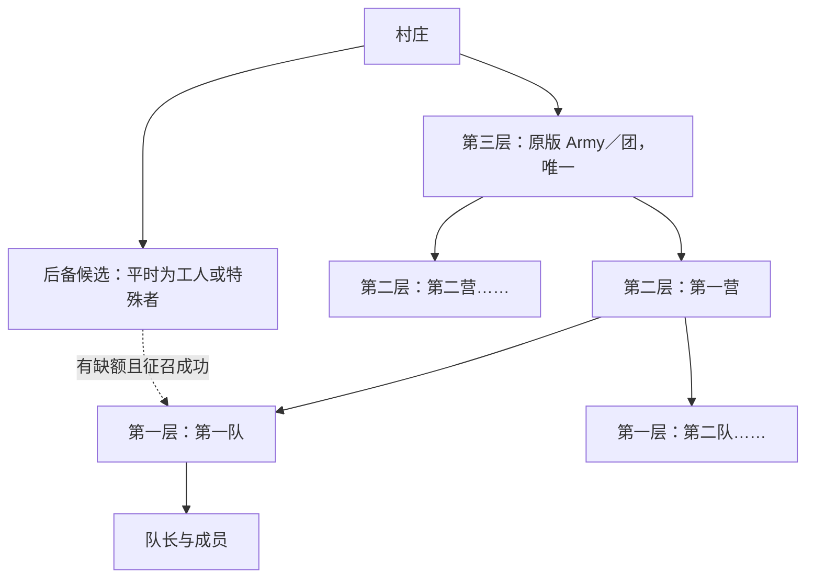

# 村庄作息与战团编制

状态：基础版已实现并验收；新增的国家军制、职业人数和操练动作见[第6阶段](村庄作息与战团编制/第6阶段-国家军制与职业人数.md)。自动派工已按真实劳动力和库存缺口修正，通过编译、61项独立规则检查及独立游戏场景中的实际领工、休息月、岗位释放和人数界面验证。

## 实现入口

- 村庄详情 → “村庄作息与军队”；原版军队详情 → “军队编制”。
- 人物原版详情显示军功，模组人物详情新增“身份与军功”页。
- 默认2–11月工作，1月和12月休息；每村分别设置十二个月，恢复默认采用相同安排。
- 三层名称、指挥称谓、数量和队列列数按国家统一修改；默认实例名按层级名称和顺序号组合，营、小队和原版军队仍可单独改名。
- 职业人数按村庄设置，默认综合人口、库存和工作需求自动安排；允许改为固定人数，林业包含伐木和补种。
- 大规模调整每村每轮最多改变32人的军籍或槽位，总览显示尚在分批整编的人数。

实现保留原版 Army 的共享战斗群组，小队复用现有协调行动系统。这样原版军令、军队旗帜和运输归属继续指向同一支军队，不增加一套重复的战斗群组转发接口。

## 已确定的玩法

1. 村庄增加“人员与军务”弹窗，允许设置工作月、休息月，以及三层编制。
2. 居民分为士兵、工人、管理者、特殊者。管理者包括村庄领主和国王，全年自由活动。
3. 所有修炼者、法师、骑士归为特殊者，全年保留原有活动，不接受强制日常劳役、操练或巡逻。
4. 特殊者已有军职时保留编制，服从明确军令；军事归属与四类人员分类分别记录。
5. 普通士兵在工作月操练、巡逻，休息月自由活动；工人在工作月领取村庄任务，休息月自由活动。
6. 袭击、紧急防卫和明确的战争命令可以打断士兵休息。战争结束后重新按当前月份安排。
7. **第三层就是原版 `Army`，一个村庄只有一个。** 它下面增加第二层、第一层，不另建并列的顶层军队。
8. 三层的名称、指挥者称谓和数量要求均可自定义：第一层设人数，第二层设下辖第一层数量，第三层设下辖第二层数量。
9. 超过编制容量的人转入后备候选名单，平时作为工人或特殊者生活；只有补缺入伍后才占正式兵额、进入小队。
10. 增加个人军功，每次有效击杀增加军功，军功影响三层指挥者的任命。
11. 成员按方格点位排列，指挥者位于前方，后方跟随矩形队伍；上级阵列按下级队伍的矩形占位排列。

## 规则概览

| 人员 | 工作月 | 休息月 | 明确军令或紧急防卫 |
| --- | --- | --- | --- |
| 普通士兵 | 按小队操练、巡逻、驻守 | 自由活动，保留军籍和编制 | 集结并执行任务 |
| 工人 | 领取村庄生产、建设、采集等岗位 | 自由活动，不领取村庄强制岗位 | 维持个人自卫、逃生；后备候选可依法补缺入伍 |
| 管理者 | 自由活动及原有管理行为 | 同左 | 保留原有决策、自卫行为，不由本系统强制编队 |
| 特殊者 | 修炼、宗门事务、研究等原有活动 | 同左 | 已有军职者接受军令，任务结束后恢复自身活动 |

“自由活动”包括进食、休息、社交、游荡及原有自主行为；不是暂停人物。后备是人员标记，不是第五类身份。

### 一个村庄的一支军队

默认示例采用“队—营—团”，均可改名：



建议默认每队 10 人、每营 10 队、全军 10 营，总编制 1000 人。每队人数包含队长，上级指挥者由下级指挥者兼任，不额外增加人口。更改第三层数量表示更改这一个 Army 的营数上限。

也可以改成“伍—曲—军”：每伍6人、每曲4伍、全军5曲，容量就是120人，顶层仍是村庄原有的那一个 Army。

编制是容纳上限，允许缺编。没有足够兵员时不生成虚假人员，也不要求凑足 1000 人才能出动。后备人员不计入原版 Army 的现役人数。

### 阵列示例

默认 10 人小队中，队长在前，9 名成员排成 3×3：

```text
              前进 ↑

                长

            01  02  03
            04  05  06
            07  08  09
```

方格点位与人物绑定，伤亡留下空位，补员填空。营按小队矩形排列，Army 按营的矩形排列；占位尺寸包含下级指挥者和间距。详细规则见第3阶段。

### 军功与任命

建议每次原版确认归属的个人击杀加 1 军功，所有身份均可获得。军功随人物保存，退役、休息、转村和转换修行身份都不清零。

选任先检查军职资格，再按“军功 → 原版军事能力 → 当前等级 → 稳定编号”排序。空缺、重编或玩家发起重新评定时任命；新增一次击杀不立即抢走现任职位。第三层统领直接对应原版 `Army.getCaptain()`。

## 原版与现有系统的依据

| 已核对的资料 | 当前事实 | 本方案采用的做法 |
| --- | --- | --- |
| [原版 City](../.GameSource/Scripts/Assembly-CSharp/City.cs)、[Army](../.GameSource/Scripts/Assembly-CSharp/Army.cs)、[CityBehCheckArmy](../.GameSource/Scripts/Assembly-CSharp/ai/behaviours/CityBehCheckArmy.cs) | 城市持有一个 `army`，军队保存统领、成员及国家归属 | 直接使用原版 Army 作第三层，仅增加下级编制 |
| [CityBehCheckCitizenTasks](../.GameSource/Scripts/Assembly-CSharp/ai/behaviours/CityBehCheckCitizenTasks.cs)、[CitizenJobs](../.GameSource/Scripts/Assembly-CSharp/CitizenJobs.cs) | 城市计算工作需求和岗位数，居民领取岗位并记录占用 | 保留原版需求与工作行为，在领取和继续任务前检查作息 |
| [原版 Actor](../.GameSource/Scripts/Assembly-CSharp/Actor.cs) | `setProfession`、`stopBeingWarrior`、`setArmy` 维护职业与军队关系；`increaseKills` 统一记个人击杀 | 后备释放、征召和军功沿用实际生命周期入口 |
| [原版 Date](../.GameSource/Scripts/Assembly-CSharp/Date.cs)、[MonthLibrary](../.GameSource/Scripts/Assembly-CSharp/MonthLibrary.cs) | 原版一年有12个月，月份由世界时间决定 | 使用原版月份和名称，不另设现实时间月历 |
| [宗门岗位服务](../Source/Content/Sects/SectJobService.cs)、[岗位容器](../Source/Core/SectJobsContainer.cs)、[岗位状态](../Source/Core/Components/SectJobState.cs) | 宗门岗位具有需求、名额、领取、释放和有效性检查；源码未提供本次所需的村庄工作／休息月历 | 借鉴岗位生命周期，村庄岗位仍由城市所有，不占用宗门岗位 |
| [宗门人事评定](../Source/Content/Extensions/SectPersonnelEvaluator.cs)、[宗门角色](../Source/Content/SectRoles.cs) | 组织身份、职位和评价依据相互区分 | 人员类别、军职、军功分开；军功与宗门贡献独立记账 |
| [混沌战帮](../Source/Content/ChaosWarbandService.cs)、[鼠群](../Source/Content/SkavenPackService.cs) | 已有长期成员关系、领队、固定阵位、巡逻与死亡后补位处理 | 复用这些组织和行动思路，新增村庄提供者，不借用神塔或鼠巢编号 |
| [协调行动](../Source/Core/Coordination/CoordinatedActivityService.cs)、[位置订单](../Source/Core/Coordination/CoordinationPlacementOrder.cs) | 支持集结、取消、角色跟随和位置变化后重新寻路 | 承担操练、巡逻和矩形阵列的执行 |
| [战术服务](../Source/Core/Combat/Tactical/CombatWorldService.cs) | 原版 Army 已有默认群组提供者；`SetDirective(Army, …)` 当前只写该 Army 群组 | 增加小队提供者时必须把 Army 军令传到下级，不能仅替换群组解析 |
| [现有工作入口](../Source/Content/Patch/PatchActor.cs)、[选择器](../Source/Core/ActorJobSelectionRegistry.cs) | 主动工作、宗门事务、集体工程和协调行动共用选工入口 | 作息判断须覆盖这些入口，并保留特殊者原有活动 |
| [身份与组织规划](魔法与骑士体系拓展/第3阶段-身份与组织.md) | 文档提出通用组织人事内核；当前本次核对的岗位与人事代码仍有宗门专属实现 | 参考其身份与权限分离原则，不把规划中的接口当成已存在依赖 |

本机原版资源实际位于 `.GameSource/Resources/` 等目录，未找到 `.GameSource/Assets/`；第4阶段列出已核实的资源文件。

## 建议默认与明确边界

- 月历为每村一份，普通士兵和工人共用。建议1—8月工作、9—12月休息，允许全年工作、全年休息或任意交错设置。
- 指挥者名称、每层数量、单位名称可以编辑。配置变化先预览补员、后备人数和阵列尺寸，再提交；战斗或运输中的人员在安全结束点完成改编。
- 特殊指挥者平时自由活动时，由本单位可执勤成员代理日常领队；正式军职不因一次缺席撤销。
- 原版征兵资格、粮食与世界规则继续有效。编制容量不是免费生成或无限征兵的额度。
- 日常操练和巡逻不发军功；军功只响应真实击杀记账。
- 本轮不实现新兵种、额外军事建筑或另一套城市、军队、宗门管理器。

## 实施顺序

| 阶段 | 交付内容 | 文档 |
| --- | --- | --- |
| 1 | 四类人员、月历、个人军功及统一任务资格判断 | [人员分类、月历与军功](村庄作息与战团编制/第1阶段-人员分类月历与军功.md) |
| 2 | 唯一 Army、两层下级编制、军功任命及后备补缺 | [编制、任命与后备](村庄作息与战团编制/第2阶段-编制任命与后备.md) |
| 3 | 工人任务、士兵操练巡逻、应急军令和矩形阵列 | [任务调度与方格阵列](村庄作息与战团编制/第3阶段-任务调度与方格阵列.md) |
| 4 | 村庄弹窗、设置预览、人员与编制树、军功解释 | [村庄弹窗与交互](村庄作息与战团编制/第4阶段-村庄弹窗与交互.md) |
| 5 | 存读档、生命周期、性能与整体验收 | [存档、性能与验收](村庄作息与战团编制/第5阶段-存档性能与验收.md) |
