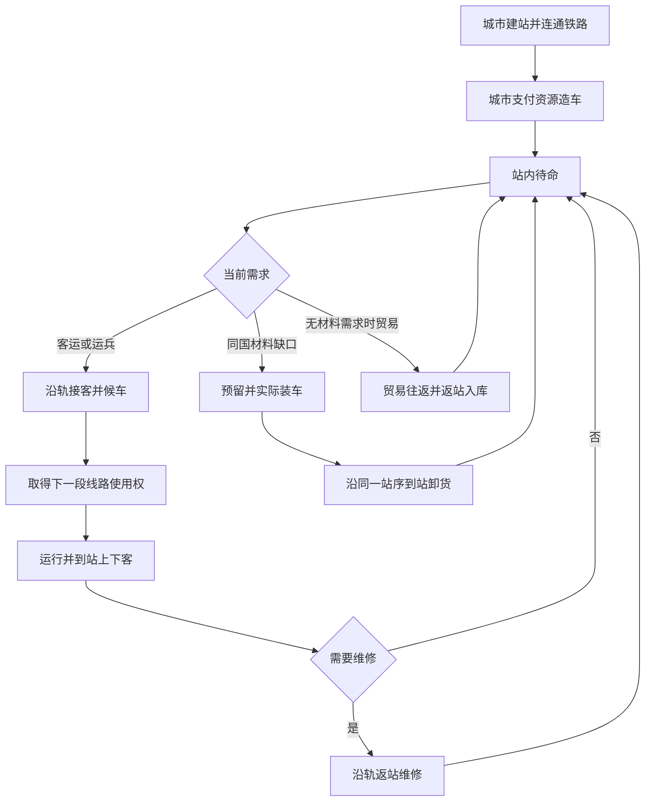

# 火车系统完善

火车系统按原版船舶的城市造车、常驻调度和贸易循环完善。目前已完成五个阶段，支持客货混合列车、同国实物材料补给、手绘铁路、断线重连，以及车站和列车信息展示。

## 实施进度

2026 年 11 月 9 日已完成第 1 阶段核心实现：实际车头和有序车厢、按车厢计算容量、完整上下车、固定站外上下客点、逻辑位置推进，以及铁路和途中行程的原版存档恢复。构建零错误，游戏内 17 项行为检查通过，详见[第 1 阶段验收记录](火车系统完善/第1阶段-验收记录.md)。

2026 年 11 月 10 日完成第 2 阶段：按合法陆地选线，建站和铺轨收费，分批施工与进度存档，断轨撤下运营连接，收费补轨或绕行，冲突区间占用及读档恢复。前方出现无法补轨的障碍时，列车疏散乘客并沿原轨倒退；退路受阻则保持原位。多站估时与实际站序共用同一结果。构建零错误，游戏内 53 项行为检查通过，详见[第 2 阶段验收记录](火车系统完善/第2阶段-验收记录.md)。

2026 年 11 月 10 日完成第 3 阶段核心调度：城市付费造车，车辆长期保留，按实际编组提供容量，空驶接客、满载分批、返站维修，同国军令按批次运输并保存人数。车站易主时保留车辆原国家，由同国可达站接管。游戏内 49 项行为检查通过，详见[第 3 阶段验收记录](火车系统完善/第3阶段-验收记录.md)。

第 4 阶段接入商船式贸易：城市优先加挂货厢，外站实际停留获得一次 5 金币，返站通过原版城市库存入库；收益与原版背包一同保存。混合列车共用原定站序，贸易在安全站为客运或军令让车，区间内不抢占。城市与列车原有信息入口可查看车辆、车厢、候车、线路和停运原因；地图只显示选中网络。二维和三维车体共用轨迹与进出站边界。另补齐城市选址和普通道路衰退的铁路规则。共 80 项游戏内检查通过，包含未暂停的原版载客贸易完整往返，详见[第 4 阶段验收记录](火车系统完善/第4阶段-验收记录.md)。

随后针对手动建站“条件不满足”的反馈，修复草地被误排除及分区候选位置遗漏，并补充具体失败提示和实际人口、库存说明。本次构建零错误，尚待重启加载后的游戏内验证，见[补充记录](火车系统完善/第4阶段-验收记录.md#建站发起问题的补充修复)。

2026 年 11 月 11 日补充断线后的生命周期：中断线路可以重新发起“连接铁路”进行补轨或合法绕行；失去线路和工程用途且没有列车占用的旧轨道恢复原版道路自然衰退；列车连续无法返站 5 分钟游戏时间后先下客，再自爆并销毁车上全部资源。规则分别列入[断轨与废轨处理](火车系统完善/第2阶段-建站铺轨与线路维护.md#断轨与维修)和[城市造车与运输调度](火车系统完善/第3阶段-城市造车与运输调度.md)。构建零错误，35 项游戏内检查通过，详见[断线处理验收记录](火车系统完善/断线处理-验收记录.md)。

2026 年 11 月 11 日完成第 5 阶段：同国城市之间实际搬运木材、石头、普通金属，预留不扣货，装车时扣源城库存，到站按实际库容与需求入库；余货留车、改送同国城市或退还，毁车明确销毁货物。客货混合沿用同一站序，无实物需求时继续原有贸易。九组75项游戏内检查通过，包含同一乘客与40单位材料的正常运输，见[第5阶段验收记录](火车系统完善/第5阶段-验收记录.md)。

同轮补充玩家绘轨与擦轨、约0.2格车节连接缝、客厢国家色、四页铁路信息面板、路线简图、车头烟囱烟雾和轨道单位击飞。铁路从车站左右侧上下居中处接入；规划允许拆除城墙、平房和自然障碍，重要设施继续绕开，见[铁路补充说明](火车系统完善/铁路手绘与界面补充.md)。

自然城市长期运营和实际高倍率的长时间稳定性仍需持续验收；当前记录区分了确定步长检查、正常原版运行和实际画面检查。

## 已确认的方向

2026 年 11 月 9 日与用户确认：

- 城市像造船一样自动造车，按运输需求发车。
- 贸易先采用原版商船的收益方式；城市资源的实际装卸另列后续阶段。
- 首期只建设合法陆地铁路，绕开海水、山体和重要建筑。
- 火车由火车头和载客车厢、货运车厢组成，容量随实际编组计算。

列车完成行程后留在世界中继续工作。空驶用于接客、返站和维修，不设置无需求也循环发车的班次。玩家可以查看和干预世界，正常运营不要求手工编排线路。

## 火车头与车厢

一列火车由 1 个火车头和按顺序挂接的车厢组成。火车头负责牵引、车辆归属和统一调度；载客车厢提供座位，货运车厢提供载货量。火车头自身不提供客位或货位，只有火车头时仅允许空驶调车。

编组支持纯客运、纯货运和客货混合。下文的“客运列车”“贸易列车”表示用途和默认搭配，不是两种结构固定的独立载具。城市按需求自动选择编组；调整车厢只在站内、整列空载且没有执行中的行程时进行。

| 部分 | 职责与建议容量 |
| --- | --- |
| 火车头 | 牵引整列车，持有原版载具编号；不直接载人或装货 |
| 载客车厢 | 每节建议 20 个座位，只分配给乘客和军队成员 |
| 货运车厢 | 每节建议 40 单位货物容量；先承载简化贸易，实物货运在第 5 阶段启用 |
| 整列火车 | 客位为载客车厢座位之和，货位为货运车厢容量之和；总长和造价分别累加各节 |

例如“火车头＋载客车厢＋货运车厢”有 20 个客位和 40 单位货位，两种容量不能互相占用。车厢类型与顺序写入存档，读档后恢复原编组。

## 现状检查结论

具体依据见[现状核查与船舶对照](火车系统完善/现状核查与船舶对照.md)。

| 优先级 | 当前问题 | 完善后的行为 |
| --- | --- | --- |
| 先修 | 下客名单中的人未必真的上过车，迟到者仍可能被放到目的站 | 只有本车实际乘客才能下车；迟到只撤销本人本次行程 |
| 先修 | 上车没有设置完整的原版乘客关系，下车没有清除运输编号 | 复用原版上下车流程，乘客死亡、车辆被毁和取消行程都能解除关系 |
| 先修 | 火车继承螃蟹巨兽的不保存设置；线路和行程主要保存在内存中 | 保存车辆、铁路和在途行程；载人读档后继续运行 |
| 先修 | 轨道受损后，行驶中的车继续沿缓存移动；取路径还会过滤缺口 | 断轨立即停止接受新行程，列车停在最后合法位置，等待修复或疏散 |
| 基础建设 | 铺轨按两站方向画线，缺少地形与工程成本判断 | 沿合法陆地选线，确认整条路线可建后才开工，按新铺部分计费 |
| 基础建设 | 列车只改显示位置，未同步所在格；没有区间占用 | 显示位置和实际位置一致；冲突线路不能同时进车 |
| 城市运营 | 每个请求生成一辆车，结束即销毁；没有归属、数量与容量 | 城市支付造价，车站管理有限的常驻列车，满载后分批运输 |
| 玩法扩展 | 缺少军队批次、通行权、贸易与运营信息 | 同国军队按命令运输，外交变化及时停运，贸易收入返站入库 |

以上问题表记录实施前的检查基线，已落地的部分以本页“实施进度”为准，剩余验收列在各阶段中。

## 如何参考原版船舶

| 原版船舶的做法 | 火车的采用方式 |
| --- | --- |
| 码头造船，检查城市资源、建造间隔和每种船的数量 | 车站造车，检查城市资源、连通线路和车辆用途数量 |
| 船有归属码头、城市与国家，运输任务分配给现有船 | 列车有归属车站，空闲车辆接单；远处有需求时先沿轨接客 |
| 乘客通过 `embarkInto`、`disembarkTo` 维护登船关系 | 使用同一套乘客承载关系，轨道移动和车站规则由火车自己处理 |
| 运输船等客、满载或超时出发；受损船返港维修 | 有限候车、按容量分批，受损列车停止接新任务并返站维修 |
| 商船到外港产生 5 金币，返港后将随身资源交给城市 | 贸易列车到目标站产生一次收益，返站入库；不扣对方库存 |
| 沉船时释放乘客，读档时按运输编号重新登船 | 列车毁坏时就近疏散，读档时先恢复承载组件再恢复乘客 |

只复用船舶中适合陆地运输的能力。列车不登记成原版船只，不加入水上寻路、码头数量统计或船舶任务。

## 完整运营流程

铁路连通与运营许可分开判断。两站之间有轨道，只说明物理上能走；车站状态、车辆归属、外交和道路受损情况共同决定现在能否发车。

乘客也分别记录“等待上车”和“确实在车内”。离开站台、迟到、阵亡或改变目的地，只影响该乘客及相应席位，不把未上车者合并到后续站点。

## 分阶段实施

| 阶段 | 完成后的可用行为 | 具体方案 |
| --- | --- | --- |
| 1 | 当前运输流程能够正确上下车、同步位置和载人读档 | [运输正确性与存档](火车系统完善/第1阶段-运输正确性与存档.md) |
| 2 | 城市建设合法陆地线路，断轨、维修和交叉占用有明确规则 | [建站铺轨与线路维护](火车系统完善/第2阶段-建站铺轨与线路维护.md) |
| 3 | 城市自动造车，常驻列车按需接客和运兵，满载分批，返站维修 | [城市造车与运输调度](火车系统完善/第3阶段-城市造车与运输调度.md) |
| 4 | 贸易列车产生并带回收益，玩家能看懂线路和停运原因 | [贸易运营与信息展示](火车系统完善/第4阶段-贸易运营与信息展示.md) |
| 5 | 在前四阶段稳定后，实际搬运城市资源并保持数量守恒 | [实物货运](火车系统完善/第5阶段-实物货运.md) |

阶段按顺序推进。第 1 阶段修复现有发车方式；第 3 阶段用常驻车辆替换“请求生成车辆、结束销毁”的代码，不保留两套运营分支。各阶段都要能独立完成行程并保存世界。

## 建议初始参数

下列是设计起点，待游戏内验证后调整，不代表已经测得的平衡数值。时间统一指游戏模拟秒，随暂停和倍率正确变化。

| 项目 | 建议值与规则 |
| --- | --- |
| 车站规模 | 沿用 10×5，占地之外明确上下客点和进出站轨道 |
| 自动建站门槛 | 城市人口至少 50、资源足够，并有一个具备建站条件的邻城 |
| 车站造价 | 木材 40、石材 20、普通金属 5、金币 20 |
| 铺轨造价 | 每 8 个新铺格子消耗木材、石材、普通金属各 1，整条工程向上取整；共用已有轨道不重复收费 |
| 火车头造价 | 木材 6、普通金属 3、金币 12 |
| 载客车厢 | 每节 20 人；造价为木材 2、普通金属 1、金币 4 |
| 货运车厢 | 每节 40 单位货物；造价为木材 4、普通金属 2、金币 8 |
| 默认客运编组 | 1 个火车头加 2 节载客车厢，共 40 人；合计木材 10、普通金属 5、金币 20 |
| 车站车辆名额 | 具有载客能力的列车最多 1 辆，具有货运能力的列车最多 1 辆；混合列车同时占两类名额 |
| 建造与加挂 | 按实际新增的火车头、车厢收费；两次新建整列车至少间隔 10 秒，加挂不重复收火车头费用 |
| 候车 | 车辆就位后基础等待 3 秒，最多额外等 7 秒；满载可提前结束额外等待 |
| 发车间隔 | 同站至少 5 秒，仍须获得线路占用许可 |
| 运行速度 | 平整陆地上以普通成年居民步速的约 3 倍为初始目标；移动与寻路估时共用换算 |
| 维修 | 生命低于 80% 不接新单；低于 25% 优先就近安全停车疏散，再处理维修 |
| 默认贸易编组 | 第 4 阶段采用 1 个火车头加 1 节货运车厢；合计木材 10、普通金属 5、金币 20，也可由混合列车承担 |
| 贸易收益 | 一次有效外站访问产生 5 金币，带回己方车站后入库 |

不在首期增加燃料、司机职业、时刻表、信号灯编辑器、桥梁、隧道或装甲列车。这些不影响上述交通循环的成立。

## 代码职责

| 位置 | 职责 |
| --- | --- |
| `Source/Content/Railways/` | 铁路选线、车辆归属、乘客行程、运营调度与贸易等玩法服务及数据 |
| `Source/Content/Systems/Logic/` | 保留逻辑系统入口，在 `Content/Manager.cs` 注册 |
| `Source/Content/ActorComponents/Train.cs` | 车头与车厢表现、接收轨道位置；不再兼任乘客名单或请求调度 |
| `Source/Content/Patch/PatchAboutTrain.cs` | 火车创建、原版读档和事件的窄范围接入；轨道贴图继续沿用 |
| `Source/Core/Pathfinding/` | 提供通用运输请求、完成结果和寻路连接；不引用新的火车业务类型 |
| `Source/Content/UI/Railways/` | 车站、列车详情及铁路显示 |

复用已有 `PortalRegistry`、`PortalManager`、`SimulationTime`、世界清理流程和原版数据的自定义字段。只在火车需要的边界扩展现有能力，不另造通用交通框架。

## 资源说明

| 资源 | 当前基础 | 规划 |
| --- | --- | --- |
| 车头、客车、货车 | `GameResources/actors/train/` 下每类 10 张方向帧 | 沿用现有 30 张，启用实际车厢编组 |
| 铁轨 | `GameResources/tiles/Cultiway.TrainTrack/` 的 11 张连接贴图 | 保留；补孤立、端点两类表达 |
| 车站 | `GameResources/buildings/civ_general/Cultiway.TrainStation/` 的完工、小图、废墟 | 保留，补站内进出站与上下客点定义 |
| 三维表现 | 已有车站资源和 `WorldfallBody.Train` 登记 | 沿用已有结果，整列车厢随轨道位置显示，不能只显示车头 |
| 图标与文字 | 建站、铺轨、列车日志图标已存在 | 优先复用原版公共动作图标，新增运营状态本地化 |

具体增补清单见[第 4 阶段资源说明](火车系统完善/第4阶段-贸易运营与信息展示.md#资源说明)。
